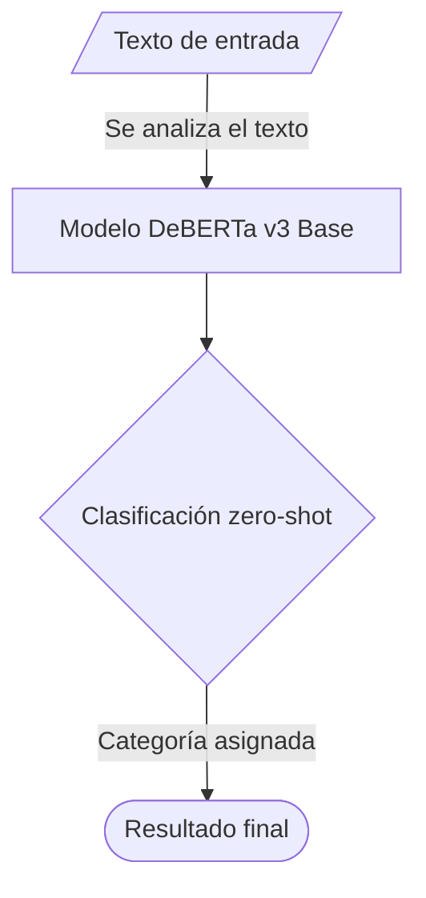

##  Modelo abierto elegido

|Dato|Respuesta|
|---|---|
|Identificador|[https://huggingface.co/MoritzLaurer/deberta-v3-base-zeroshot-v2.0](https://www.google.com/url?q=https%3A%2F%2Fhuggingface.co%2FMoritzLaurer%2Fdeberta-v3-base-zeroshot-v2.0)|
|Tarea (pipeline tag)|`zero-shot-classification`|
|Número de parámetros|~0.2 mil millones (200,000,000)|
|Licencia|El modelo base se publicó bajo la licencia MIT. Las licencias de los datos de entrenamiento varían según el modelo|
|Limitación o sesgo declarado|El modelo solo puede realizar tareas de clasificación de texto. Los sesgos pueden provenir del modelo base subyacente, de los datos de entrenamiento NLI humanos y de los datos sintéticos generados por Mixtral.|
## Caso de uso

